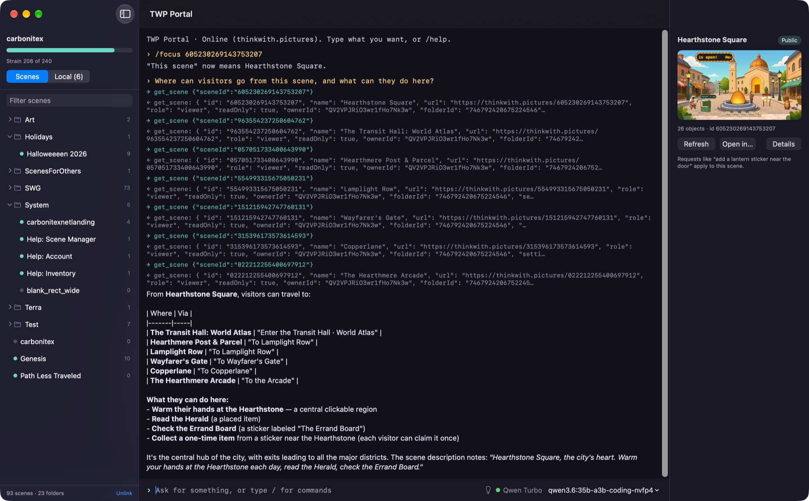
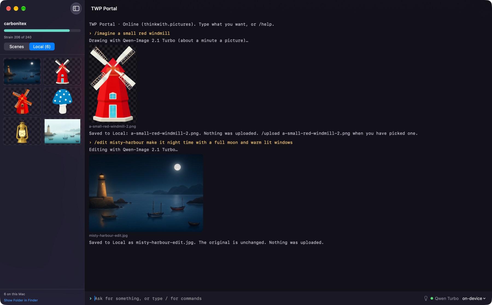
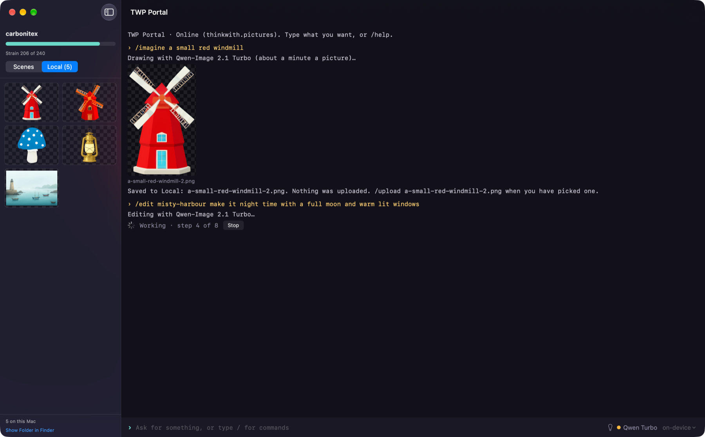

# TWP Portal for Mac

A native macOS companion for [thinkwith.pictures](https://thinkwith.pictures): link it to your account once, then build and edit scenes from a terminal-style window, in plain words or with direct commands. The language model and the image model are Apple's, running on the Mac. No API key, no model download. A local Qwen-Image server can optionally take over picture drawing and adds editing and filling.

> **Needs macOS 27 on Apple silicon with Apple Intelligence turned on.** This first release is source only: build it yourself with the two commands under [Build and run](#build-and-run). Signed, ready-to-run downloads will come soon.



*Your scenes and folders on the left, the conversation in the middle, a live preview of the scene in focus on the right. Here a local model (the optional `/brain local`) reads the public scene Hearthstone Square and its neighbours to answer a question.*

| Draw and edit pictures on your Mac | Progress, with a Stop button |
|---|---|
|  |  |

*Pictures stay on the Local shelf (left) until you upload one. These two were made with the optional Qwen-Image engine; Apple's Image Playground is the default.*

It is a client of the site's Scene Builder MCP endpoint (`/api/twp/mcp`), the same one any MCP-capable assistant can connect to; see <https://thinkwith.pictures/agents>. Everything it does is done as the signed-in user and spends their strain exactly as the website would.

## What is in here

| Target | What it is |
|---|---|
| `PortalCore` | Sign-in (OAuth 2.1, dynamic registration, PKCE, loopback redirect), the MCP client, the agent, the image pipeline |
| `twp` | Command-line front end: `twp login`, `twp scenes`, `twp ask "…"`, or `twp` alone for an interactive prompt |
| `TWPPortal` | The SwiftUI app: scene list, terminal, live scene preview |

## Requirements

- macOS 27 on Apple silicon with Apple Intelligence turned on.
- To build: the Command Line Tools (`xcode-select --install`). Xcode is not needed.

## Build and run

```sh
sh scripts/build.sh        # build/twp and build/TWPPortal
sh scripts/build.sh app    # also dist/TWP Portal.app and dist/TWP-Portal-mac.zip
open "dist/TWP Portal.app"
```

`scripts/build.sh` calls `swiftc` directly and is the tested way to build. A `Package.swift` is included for SwiftPM and Xcode users, but it has not been verified yet; please open an issue if `swift build` fails for you.

An app built this way is signed ad hoc, which is fine on the Mac that built it.

## Using it

1. Choose **Link Account…** (or type `/login`). Your browser opens the site's own consent page; approve there. No password is typed into the app.
2. Type what you want: *"make a new scene called Harbour with that background"*, *"add an iron boots sticker in the middle of this scene"*, *"make it twice as big"*.
3. Or use commands, which never involve a model: `/scenes`, `/scene <id>`, `/preview`, `/upload <file> [sticker|background]`, `/cutout <file>`, `/imagine <text> [--background]`, `/call <tool> <json>`. `/help` lists them all.

Users only ever see production ("Online"), so the app shows no environment picker. A developer running their own server can point the portal at it by origin: `twp --env http://localhost:8798 …` for one run, or `twp use http://localhost:8798` to make the CLI and the app both use it (the app then shows a picker with Online and that server; `twp use prod` goes back).

While nothing has been asked yet, the chat area shows a library of suggestion cards (`Starters.swift`), built from the user's own scene names, the focused scene and the Local shelf. Cards marked with a return arrow only look things up and run on click; cards marked with a pencil change the account or spend strain, so they are placed in the input to edit and confirm. The lightbulb beside the input brings the library back at any time, and typing `/` lists the matching commands above the input.

Publishing a scene, removing objects and destructive `api_call` operations always ask for confirmation first, whatever the model decided. In the CLI without a keyboard they are refused unless `--yes` is passed.

## The game, inside the window

The gamepad button in the toolbar (or `/game`, or ⌘G) shows the live game beside the chat: the real website in an embedded web view, not a picture of it.

- **It is signed in as you.** Linking asks for one extra permission, "Open the game signed in as you". With it the app fetches a one-time, one-minute sign-in code and hands it straight to the web view; the code is never shown, logged or given to a model. If you linked before this existed, the bar above the game offers "Link Again to Sign In…".
- **The chat follows the game.** Pick a scene in the sidebar and the game walks there; walk through a door in the game and that scene becomes "this scene" for your next request. After a request changes a scene, the game loads it again.
- **View as guest.** The person-with-a-question-mark button shows the same scene in a second, cookie-less view: exactly what a visitor who is not signed in sees. `/game guest` and `/game me` switch from the keyboard.
- **Its sign-in is a normal website session** kept in this app's own web data, separate from Safari. The app and its game are one unit, though: `/logout` signs the game out as well, and revoking the app on the website's connected-apps page ends the game's session along with the chat link.

## How the agent fits a small model

Apple's on-device model has an 8,192-token context window, and the 28 tools' schemas alone are larger than that. So each request runs in two steps:

1. **Route.** A tool-less session picks up to four tools from a one-line catalogue (`AgentTool.routerHints`), using guided generation so it can only answer with real tool names.
2. **Act.** A fresh session gets just those tools. Schemas are converted from the server's JSON Schema at runtime (`SchemaBridge`), with descriptions clipped and, for the small model, only the everyday optional arguments offered (`AgentTool.everydayArguments`), because small models fill in optional arguments nobody asked for.

Tool output is compacted before the model sees it, and a short memory (recent turns, recent tool results, the focused scene) carries context between requests. When the model has a larger window (Private Cloud Compute is 32K), the router is skipped and full schemas are used.

Expect the on-device model to handle one- to three-step requests well and to struggle with long plans. `/call` reaches every tool with full arguments.

### Optional: your own local model

For longer plans, the portal can hand plain-language requests to a model server you run yourself instead of Apple's model: anything that speaks the OpenAI chat-completions API with tool calling, such as [Ollama](https://ollama.com), llama.cpp's `llama-server` or LM Studio, with whatever GGUF or MLX model you like. Nothing ships with the portal and Apple's model stays the default.

- `/brain local` switches to it (`/brain on-device` goes back); the model menu beside the input does the same and lists the server's models.
- The server is found on the usual local ports (11434, 8080, 1234), or set it with `/brain server <url>`. Choose the model with `/brain model <name>`. With none chosen, the portal picks `gemma4:e4b` if the server has it, or the `qwen3.6` coding model on a Mac with 64 GB or more (the two that passed every test below); `/brain model auto` returns to that.
- The portal assumes a 32,768-token window (`/brain context <tokens>` to change it). With that much room the router is skipped: the model gets every tool with its full schema and runs up to 16 rounds of tool calls per request. Make sure your server really loads the model with a window that large; some default to far less and cut the prompt silently.
- The confirmation prompts for publishing and deleting, and the local-first rule for pictures, apply to every model alike (`LocalBrain.swift`).

How well this works depends on the model's tool calling, and bigger is not reliably better. Measured under Ollama on six tasks (a lookup, reading a scene, a multi-step build, a search with no result, a three-turn edit, a refused delete), one run each:

| Model | Size | Passed | Typical seconds per request |
|---|---|---|---|
| qwen3.6 35b-a3b coding | 21 GB | 6 of 6 | 9 |
| gemma4 e4b (QAT) | 6 GB | 6 of 6 | 11 |
| gemma4 8B | 10 GB | 5 of 6 | 12 |
| qwen3.8 27b | 31 GB | 5 of 6 | 25 |
| gemma4 31b | 20 GB | 5 of 6 | 64 |
| nemotron-3.5-lightning 30b | 22 GB | 4 of 6 | 13 |
| qwen3.5 9b | 7 GB | about 1 | 18 |
| lfm2.5-thinking 1.2b | 1 GB | 0 | 11 |

Models without tool support (gemma3, for one) cannot be used at all.

## Images and the Local shelf

Pictures stay on the Mac until the user uploads one. The Local shelf is a plain folder, `~/Pictures/TWP Portal` (override with `TWP_PORTAL_SHELF`), shown in the app's **Local** tab; `shelf.json` beside the files remembers prompts and which files were uploaded where. Files can be added or removed in Finder.

- `/imagine <text> [--background]` draws a picture and saves it to the shelf. `/cutout`, `/import` and dropping a file on the window also only touch the shelf. Nothing is uploaded and no strain is spent.
- `/upload <name>` (or **Upload** in the Local tab) is the one step that sends a picture to the TWP gallery, through `begin_image_upload` and a plain PUT to the one-time URL.
- The agent's `generate_image` tool follows the same rule with one exception: when the same request goes on to use the picture ("draw a chest and add it to this scene"), it uploads at once, because the user asked for it to be used. A bare "draw me a mushroom" stays local.
- Generation goes through Apple's Image Playground. The programmatic `ImageCreator` is tried first, but Apple deprecated it in macOS 27 and on the development Mac it always answers `notSupported`, so in practice the app opens the Image Playground sheet with the prompt and style filled in and takes the picture the user accepts. One picture per request. It needs the app window, so `/imagine` does not work from the bare `twp` binary.

### Optional: bring your own Qwen-Image server

Image Playground only draws new pictures. For editing and filling, and for drawing without the sheet, the portal can call a server you run yourself that serves Qwen-Image 2.1 on the same Mac or the local network. No such server ships with this project and none is needed for anything else; the contract is small (below) so one can be written around any Qwen-Image setup. It is off unless chosen:

- `/pictures qwen-turbo` (8 steps, about a minute a picture) or `/pictures qwen` (40 steps, several minutes); `/pictures apple` goes back. `/pictures server <url>` sets the address (default `http://127.0.0.1:8740`).
- `/imagine` then draws through the server: stickers come back with real transparency and are trimmed, backgrounds are 1216×832, and `x3` really makes three. It also works from the bare `twp` binary.
- `/edit <name> <what to change>` repaints a picture as instructed and saves a copy.
- `/fill <name> <area> <what>` paints into one rectangle (`left,top,width,height` in percent, or `bottom-left` and similar). The rectangle is marked in magenta for the model and the answer is blended back through a soft mask, so pixels outside it are untouched. In the app, **Fill…** on a Local picture opens a sheet to drag the box.
- The light beside the input shows the model's state: hollow when not in memory, green when loaded, amber while working, red when the server is not answering. Its menu switches engine, unloads the model, and sets an idle time after which the portal unloads it (while the portal is open).

The contract is one call, `POST /generate-image` with JSON `{prompt, model: "turbo"|"base", width, height, alpha, images: [base64…]}` answering with PNG bytes (`PictureEngine.swift`). Loaded state, step progress and unloading come from the daemon's unix socket (`status` and `unload` over `POST /rpc`), looked for at `$LOCALGEN_HOME/.run/daemon.sock` and `~/local-generators/.run/daemon.sock`, or set with `/pictures socket <path>`; without it pictures still work and the light only shows reachable or not.
- Stickers must be transparent, so generated stickers and `/cutout` go through Vision's foreground-subject mask.

## Private Cloud Compute

`/brain private-cloud` switches to Apple's server model. It reports available but refuses requests unless the app is signed with Apple's managed Private Cloud Compute entitlement (<https://developer.apple.com/private-cloud-compute/>).

## Where things are stored

- Sign-in: a build signed with a Developer ID keeps it in the login Keychain (service `pictures.thinkwith.portal`, one item per environment). An ad-hoc build (every local `scripts/build.sh`) keeps it in a `0600` file in `~/Library/Application Support/TWP Portal/` instead, because the Keychain treats each ad-hoc rebuild as a different app and would ask for the login password repeatedly. `TWP_PORTAL_TOKEN_FILE=1` forces the file, `=0` the Keychain.
- `~/Library/Application Support/TWP Portal/`: `config.json` (environment, model), `clients.json` (registered OAuth client ids).
- Access tokens last an hour; refresh tokens rotate on every use. The CLI and the app share one grant and refresh under a file lock, because replaying a spent refresh token revokes the grant.
- Revoke from the app (**Unlink**), `/logout`, or the website's Account window under Connected apps.

## Distributing it

`scripts/build.sh app` signs ad hoc, which runs on the Mac that built it. Other Macs need a Developer ID signature and notarization:

```sh
CODESIGN_IDENTITY="Developer ID Application: <name> (<team>)" sh scripts/build.sh app
xcrun notarytool submit dist/TWP-Portal-mac.zip --keychain-profile <profile> --wait
xcrun stapler staple "dist/TWP Portal.app"
```

## Development notes

- No Swift macros that need Xcode's plugins: no `@Generable` (schemas are built with `DynamicGenerationSchema`), no `@State` or `@Observable` in the app (`ObservableObject` instead).
- `TWP_PORTAL_RUN` holds newline-separated lines the app runs at launch, for demos and checks.

## Licence

MIT. See [LICENSE](LICENSE).
